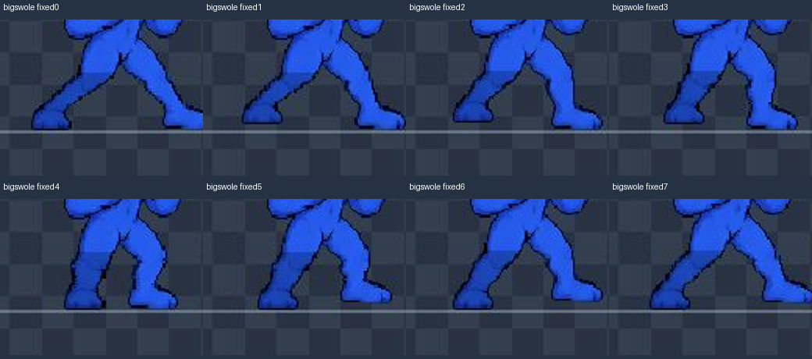
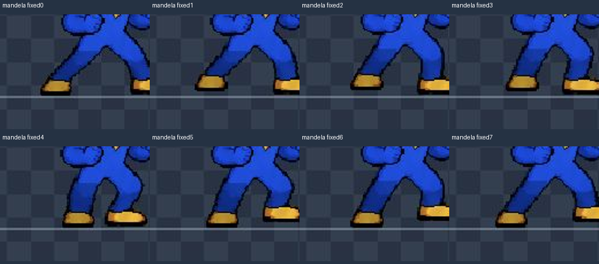
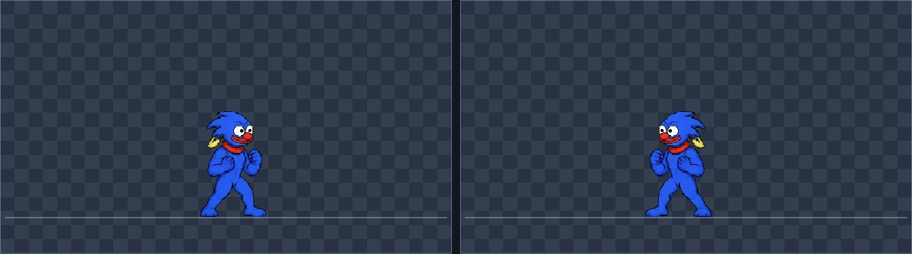
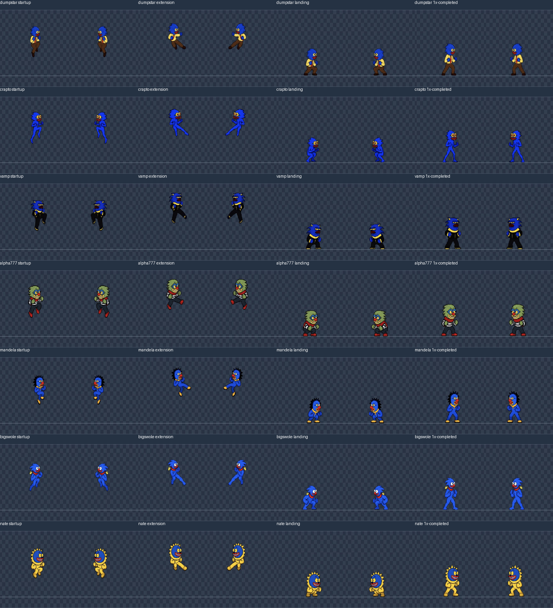

# Last-seven browser recheck — 2026-11-01

## Result

**The reported Big Swole inner-leg projection was reproduced and the specific pelvis-join fix passes this focused visual recheck.** A smaller matching projection on Mandela was also found and is absent after the correction. This is not a blanket animation-quality approval.

All seven fighters were examined individually in a fresh Chrome atlas-lab tab through CUA UI controls, using actual core actions and both normal/mirrored panels. No source or asset changes were made by this reviewer. Existing October31 full-scenario coverage remains prior evidence; it is not relabelled as today's testing. The initial captures preceded movement-speed tuning; the final targeted follow-up below uses the reloaded tuned build.

## Current evidence and coverage

[Evidence directory](evidence/2026-11-01-last-seven/) contains **283 original browser screenshots**, seven derived magnified join montages, [coverage.csv](evidence/2026-11-01-last-seven/coverage.csv), and [displayed debug observations](evidence/2026-11-01-last-seven/observations.json).

- Seven fighters × 17 paused captures: all eight current walk indices; medium startup/contact/recovery; light startup/contact/recovery; aerial-medium contact; walking reversal; stopped guard.
- Eight additional Big Swole walk captures preserve the initial reproduction separately.
- After **Reload assets** for the parent's reported `whole-pose-pelvis-3` revision: eight fresh walk indices each for Big Swole and Mandela.
- Thirty-five selected-1× running screenshots each for the two corrected fighters. Big Swole's observed debug span was coreframes13–90; Mandela's was14–99. These span repeated wide/narrow steps and reversal. They do not reach the stopped state in the post-fix run; stopped-state captures exist from the focused check before the asset-only correction.

Paused captures have exact frame correspondence. Running debug text was read immediately before the screenshot, so those labels are adjacent observations rather than a guarantee of the screenshot's exact frame. Both panels are the same simulation with a rendering mirror, not two independent control-facing runs. Captured images were inspected directly and in magnified review montages; this is sampled playback, not continuous video viewing.

| Fighter | Medium startup/contact/recovery core frames | Light startup/contact/recovery | Air medium contact | Reversal / stop |
|---|---|---|---:|---|
| Dumpstar | 3 / 8 / 22 | 3 / 6 / 14 | 16 | 66 / 125 |
| Crapto | 3 / 8 / 23 | 3 / 7 / 15 | 16 | 66 / 125 |
| VAMP | 3 / 8 / 22 | 3 / 6 / 14 | 16 | 66 / 126 |
| Alpha 777 | 3 / 8 / 23 | 3 / 7 / 15 | 16 | 66 / 124 |
| Bitcoin Mandela | 3 / 8 / 23 | 3 / 7 / 15 | 17 | 66 / 126 |
| Big Swole | 3 / 8 / 23 | 3 / 7 / 15 | 16 | 67 / 127 |
| Little Foot Nate | 3 / 8 / 23 | 3 / 7 / 15 | 16 | 66 / 126 |

The eight walk indices were reached through UI stepping in the real walk action, not by replacing the rendered frame manually. Attacks ran at quarter speed and were paused on the displayed contact/recovery slot. Reversal/stop ran at selected1× and were paused at the recorded checkpoints.

## Reproduction and correction

Before the patch, **Big Swole walk0 and7** had a pointed blue shape projecting downward from the middle of the pelvis into the leg gap. Walk1/2 exposed a dark V/split at that join. Narrow walk4 closed the gap, so cycling between wide and narrow frames made the central shape appear/disappear. The mirrored panel reproduced it, pointing to an asset join rather than a facing transform. The initial runtime crops are preserved as `bigswole-before-0.png` through`7.png`.

Magnified comparison of all eight joins for the other six found a smaller version on **Mandela walk0**, with a small edge point in7. This was reported to the parent before the fix. Alpha's small dark line under the striped shirt appears to be a trouser seam; it did not form the same projecting blue wedge.

After reload, Big Swole and Mandela's eight corrected frames show an intact central pelvis contour and open leg gap without the hanging point. The normal-speed samples show no recurrence as the stance opens, closes and reverses. Feet and characteristic body textures remain connected. This supports accepting the **specific projecting-join correction**. It does not establish perfect gait, foot locking, or every possible transition.

## Individual current findings

| Fighter | Fresh visual assessment |
|---|---|
| Dumpstar | All eight joins are continuous; brown trousers and shoes show no comparable central projection. Ground kick, punch and airborne kick remain attached; planted recovery13 avoids the old crouch dip. |
| Crapto | Thin blue legs keep a clear inner gap across all eight frames. No matching hanging pelvis shape found. Extended limbs remain connected in the sampled kick/punch/air-kick phases; rear knee contour is still angular in compressed steps. |
| VAMP | Black/yellow shoes and trouser silhouette remain coherent across all eight joins. Corrected ground kick still ends in a shoe. Recovery stays planted. No new projecting inner-leg shape seen. |
| Alpha 777 | Striped shirt, dark trousers and red shoes remain coherent. Small dark trouser-seam detail is visible at the crotch, but no detached or hanging projection was established. All sampled attack phases have connected limbs. |
| Bitcoin Mandela | Smaller central projection reproduced before patch; corrected eight-frame joins are clean afterward. Spikes/yellow feet remain present. Ground/air kick and light attack phases remain coherent. |
| Big Swole | Reported projecting join reproduced, then absent in all eight corrected frames and normal-speed samples. White eyes/earring/muscle detail preserved. Ground kick, light attack and aerial kick are connected in the focused captures. |
| Little Foot Nate | No analogous projecting shape in eight magnified joins. Round face/native feet retain their shape. Ground kick, punch and air kick retain connected anatomy; planted recovery remains in use. |

## Remaining limitations

The movement still uses a guarded widening/narrowing step cycle with modest lift and a mostly steady upper body. This review does not claim world-space foot locking, natural full-stride walking, or complete animation smoothness. Rapid whole-pose changes can still read as discrete authored poses. The previously documented paired-throw art limitation was outside today's targeted scope. The final movement follow-up below adds sampled coverage after the speed tune; it does not establish continuous animation smoothness or replace hands-on player feedback.

## Final movement-tune follow-up

After page reload on the parent’s stable movement tune and `whole-pose-pelvis-4` asset revision, all seven were exercised through real core scenarios: forward walk, reversal, stop, jump, dash at selected 1×; ground medium at quarter speed. Ten paused screenshots per fighter were inspected in both rendering panels. These add 70 unique screenshots. A missed narrow Big Swole pause window was repeated successfully; two preliminary log entries remain, so observations.json has 285 entries for 283 original screenshots. Seven join montages bring the PNG file count to290.

| Fighter | Forward / reverse / stop | Jump rise / fall / landed | Dash start / ended | Kick contact / planted recovery |
|---|---|---|---|---|
| Dumpstar | 23 / 65 / 124 | 4 / 26 / 48 | 1 / 17 | 8 / 23 |
| Crapto | 22 / 62 / 123 | 4 / 25 / 47 | 1 / 18 | 8 / 23 |
| VAMP | 23 / 65 / 125 | 4 / 26 / 48 | 1 / 17 | 8 / 22 |
| Alpha 777 | 22 / 62 / 122 | 4 / 26 / 48 | 1 / 17 | 8 / 22 |
| Bitcoin Mandela | 22 / 63 / 122 | 4 / 26 / 47 | 1 / 17 | 8 / 23 |
| Big Swole | 22 / 63 / 122 | 4 / 26 / 48 | 1 / 17 | 8 / 22 |
| Little Foot Nate | 22 / 63 / 123 | 4 / 26 / 48 | 1 / 16 | 8 / 23 |

Every stopped checkpoint displayed guard0; every kick-recovery checkpoint displayed planted recovery13. Jump rise8, fall9 and landed guard0, and dash6→guard0 were reached for each fighter. No new detached joint, hanging pelvis projection or recovery crouch dip appeared in these samples. Big Swole and Mandela retain the corrected pelvis. Ground kicks keep each fighter’s native foot/shoe and connected support leg.

Critical interpretation: the characters travel and reverse with the new core timing, but the visual gait remains a short guarded step, not a full alternating natural walk. Dash uses one strong lean pose; jump uses a small number of discrete poses. These samples support absence of the specific anatomy regression and correct state transitions, not a claim that every intermediate animation is fluid. The browser executed at selected1×; screenshots are sampled observations, not a continuously recorded video or measured input-latency test.

## Downward air-heavy timing follow-up

A fresh lab tab was opened after the parent’s core change delaying the downward impulse until active startup. Each of the last seven used Action airHeavy, direction down, loop off. Exact startup/extension/landing captures were UI-stepped; each action was then replayed at selected1× through recovery. Narrow active-frame waits at1× proved unreliable because browser-tool latency skipped the capture window; these failed waits are not counted as visual evidence. The 1× endpoint alone is not a continuous-motion recording.

28 additional original screenshots and [separate displayed-state log](evidence/2026-11-01-last-seven/down-airHeavy-observations.json) preserve this retest. The log also retains one superseded initial Dumpstar startup observation; its screenshot was replaced by the exact stepped checkpoint.

| Fighter | Startup core frame | First extended23 core frame | First grounded landing10 frame | 1× replay endpoint guard0 |
|---|---:|---:|---:|---:|
| dumpstar | 10 | 17 | 28 | 47 |
| crapto | 10 | 17 | 28 | 46 |
| vamp | 10 | 17 | 28 | 47 |
| alpha777 | 10 | 18 | 29 | 48 |
| mandela | 10 | 17 | 28 | 52 |
| bigswole | 10 | 25 | 35 | 45 |
| nate | 10 | 17 | 28 | 48 |

All seven reached airKickFull23 while still airborne, then crouchLanding10 and guard0. Big Swole’s slower startup extended at core25 and landed at35, so the corrected dive no longer consumes his entire startup before an airborne active pose. Dumpstar’s extra exact-step observation showed y483.7 at t1, y449.5 at t7, y446.7 at active t8, then y455.6 at t9: ascent continued through startup and the dive followed activation. Both mirrored panels show attached limbs in the sampled poses.

A separate parent concern about Big Swole head shrink was checked against these same-scale runtime captures: no dramatic head reduction between guard0 and air22/23 was evident here. VAMP’s airborne head appears modestly narrower/smaller than guard, and Alpha’s narrower silhouette also varies. This is a visual comparison, not source bounding-box measurement; it does not certify identical head scales. No art edits were made.

