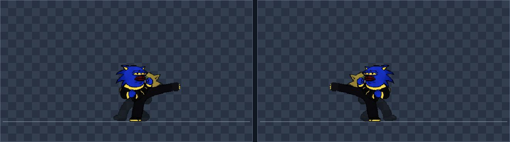
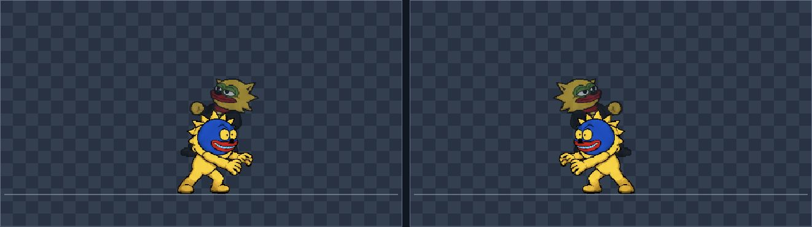
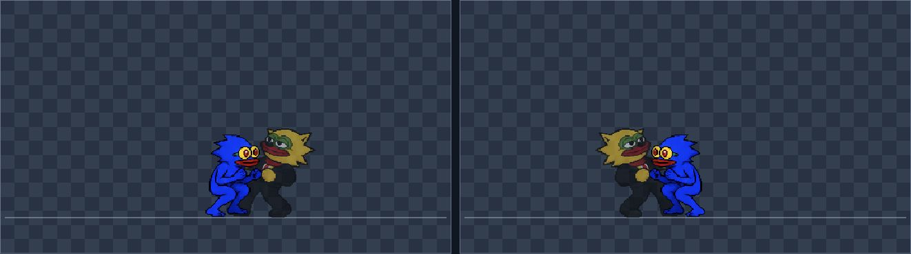
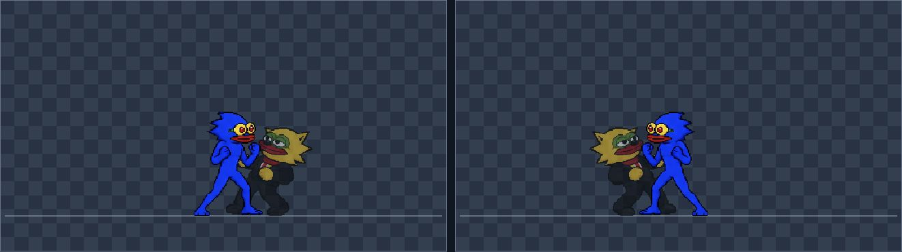
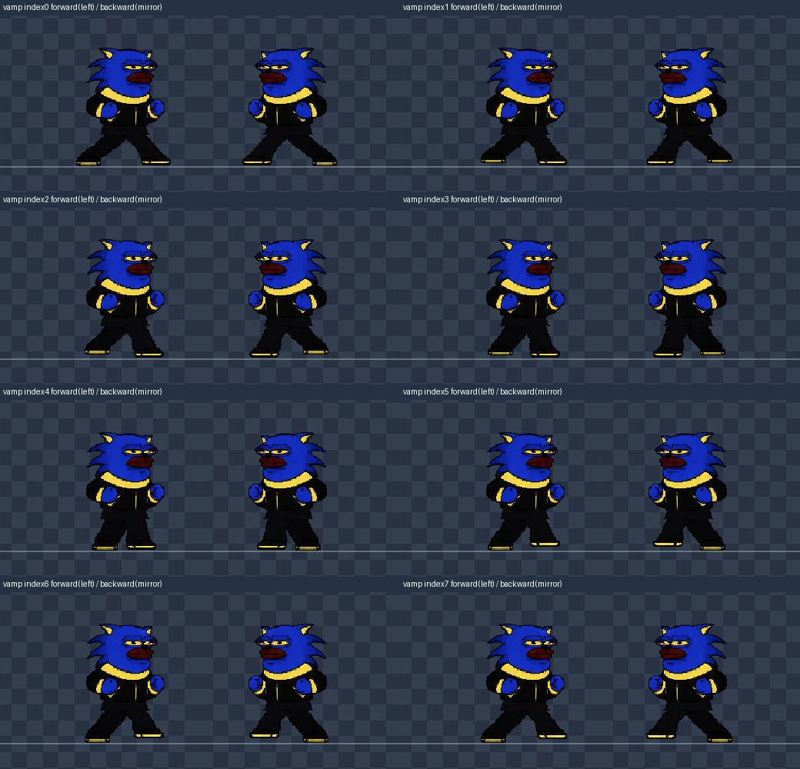
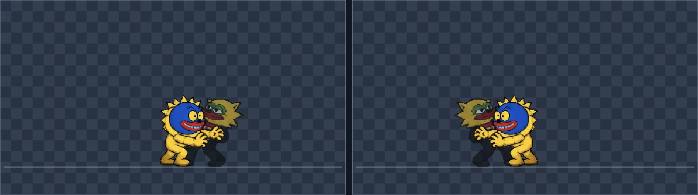
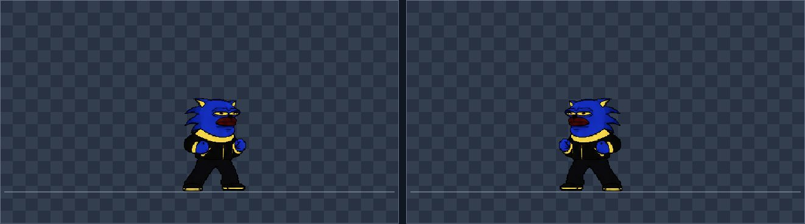

# Current runtime motion review — last seven fighters

Reviewed 2026-10-31 in a dedicated Chrome tab at `/art/pose-atlas-lab.html`, using CUA UI controls only. Fighters: Dumpstar, Crapto, VAMP, Alpha 777, Bitcoin Mandela, Big Swole, Little Foot Nate. No source, manifest, or sprite assets were changed for this review.

**Verdict: sampled anatomy is connected and current corrected sprites are visible; motion quality is not approved wholesale.** The original hold alignment was inadequate; the final presentation recheck below confirms improved forward contact. Direction-specific paired throw choreography is still limited. The ground-medium recovery crouch was confirmed, changed by the parent, and rechecked at coreframe25 for all seven: the current pose is planted slot13 with no deep crouch at that checkpoint. Direction-specific paired throw choreography remains limited; the later forward-contact presentation fix is checked at the end of this report.

## Evidence and exact coverage

[Evidence folder](evidence/last-seven/) contains **301 PNGs: 43 per fighter**, each showing actual-state and mirrored panels. [coverage.csv](evidence/last-seven/coverage.csv) records displayed core frames/slots/move timing/throw states. [observations.json](evidence/last-seven/observations.json) preserves accessibility observations, including repeated/interrupted attempts. Dumpstar's initial medium frame 8 was captured separately as `dumpstar-medium-f8.png`; its exact UI readout was medium t7, slot18, freeze4.

Per fighter:

| Capture group | Count | Actual coverage |
|---|---:|---|
| Paused core contacts | 9 | medium frame8/t7/slot18; light frame7/t5/slot12; launcher frame10/t8/slot15; airMedium frame16/t7/slot23; hit frame7/slot24; block frame7/slot25; forward attacker/victim hold frame9/t0, slots27/24; special coreframe20 (slot30 except Nate29). |
| Running full motion review at selected 1× | 22 | Idle, forward/back walking, dash, jump, light, medium, sweep, launcher, bolt, airMedium, hit, block, four attacker throw directions, four victim directions, special. Each scenario was sampled after its visible label appeared. |
| Quarter-speed release, then paused | 8 | Forward/back/up/down, attacker and victim roles. Actual release state t0–1, recorded per capture. |
| Quarter-speed recovery, then paused | 2 | Medium slot19 and subsequent slot10. |
| Quarter-speed planted recovery, then paused | 1 | Light recovery slot13, evaluated as candidate medium recovery replacement. |
| Post-fix quarter-speed medium, paused/stepped to frame25 | 1 | All seven show slot13 with grounded feet, replacing the prior deep crouch. |

Each capture includes both facing panels, but the second is a **rendered mirror of the same simulation**, not an independent left-facing input run. Running screenshots follow their AX observation by tool latency: the reported AX frame is adjacent evidence, **not an assertion that the screenshot contains that exact frame**. Only paused captures establish matching frame/pose evidence. This is sampled playback with inspected images, not continuous video viewing or exhaustive inspection of every intermediate frame.

A source reload interrupted an early Crapto attempt; it was restarted. A Big Swole scenario wait missed a label while playback advanced; the full 22-scenario capture was repeated successfully. A long manual stepping call timed out during Dumpstar release collection; all eight releases were recaptured using quarter-speed playback, paused on release, and saved individually. These interrupted attempts are not counted as extra coverage.

The new eight-frame walk assets were reloaded before the full-cycle runs. The initial walking observations sampled forward/back scenarios. The later dedicated walk follow-up below inspects all eight installed frames in both travel directions; continuous foot-contact quality remains a separate limitation. Earlier rejected flat-leg drafts and stale raw-atlas defects are not carried into the verdict.

## Findings by fighter

Recovery10 comments below describe the initial captures, retained as before/after evidence. The final frame25 recheck uses slot13 for all seven and removes that deep crouch at the sampled checkpoint.

| Fighter | What the current captures show | Remaining concern |
|---|---|---|
| Dumpstar | Yellow shirt/red tie, blue head/hands and brown trousers remain readable. Ground kick ends in a shoe; punch, uppercut and air kick remain connected. | Hold hands stay near the chest while the larger opponent overlaps above/behind. Slot19→10 produces an obvious downward body change. |
| Crapto | Slim unclothed blue silhouette, long muzzle and thin limbs remain continuous in punch/uppercut/ground and air kicks. No old rig neck gap visible. | Tall stance collapses into a conspicuous crouch in recovery10. Thin extended foot has less visual weight than the other fighters. Throw release uses the same two-hand-forward gesture for all directions. |
| VAMP | Current ground kick visibly has the black/yellow shoe, not the earlier rejected fist-shaped end. Dark outfit and yellow trim stay coherent; air kick and hit pose have attached limbs. | Throw hold looks like a guarded stance beside an overlapping victim. Recovery10 adds a crouch after the knee retracts. |
| Alpha 777 | Green face, striped sleeves/shirt, red scarf and shoes remain readable. No checkerboard holes in extended arms or leg. | Small body makes the large opponent's unsupported overlap especially apparent. Recovery10 is a large height change. |
| Bitcoin Mandela | Radial black spikes survive uppercut, kick and hit poses; yellow feet stay recognizable. | Hold pose does not visibly grip the opponent; back/up relocation changes the opponent's position while the attacker still releases forward. |
| Big Swole | White eyes, gold earring and broad blue muscular body remain visible. Ground kick, punch and air kick show continuous anatomy. Current installed slots are usable; no claim based on the old raw sheet's cell count. | Raised-arm special preparation and low release pose create a strong height change; intermediate smoothness is not established by these samples. Deep recovery crouch is pronounced. |
| Little Foot Nate | Current round face, pale blue teeth, yellow body and spiked outline remain consistent between the captured actions. Kick foot and supporting leg read as attached. | Large opponent obscures the small attacker during hold; release is an open-handed forward reach regardless of direction. Recovery10 introduces a deep squat. |

## Shared issues and recommendations

1. **Throw choreography remains unfinished.** At coreframe9, hold t0, the victim is at 48 world pixels forward and 26 pixels above the attacker, while the attacker's hands remain near their own chest. Across all seven, this reads as overlap rather than a deliberate grip. At release, back and up visibly relocate the victim, but the attacker uses the same forward release silhouette; the victim uses the same hit pose. The sampled silhouettes remain connected, but that is not sufficient for a convincing paired throw. A genuine fix needs matching authored hand/contact anchors and appropriate paired release poses; merely moving or rotating a whole body cannot provide missing limb action.
2. **Medium recovery dips unnecessarily.** All seven current slot19→10 captures visibly lower the whole torso into a separate crouch, particularly Crapto, Big Swole and Nate. Slot13 was then inspected live for all seven: feet are planted and bodies continuous without the deep dip. Recommended sequence: contact18 → brief retract17 where it is actually a half extension → chamber19 → planted13 → guard0 near recovery end, preserving combat timing. The parent implemented this sequence without changing combat timing. A fresh browser reload followed by quarter-speed playback and stepping to coreframe25 confirmed planted slot13 for all seven; images `*-medium-postfix.png` preserve that result. The previous crouch images remain as before evidence. This targeted recheck establishes the corrected recovery checkpoint, not every intervening frame.
3. **Limited authored phases still limit smoothness.** A connected contact pose does not validate the transition into or out of it. The special observations cover startup and an early contact/charge sample, not every last-burst pose or the main game's teammate/VFX composition. This lab does not draw that complete cinematic.
4. **Walking is not approved as finished natural movement.** The dedicated follow-up below now covers all eight frames in both travel directions and normal-speed samples through reversal/stop. The remaining shuffle/stop-transition limitations are recorded there.

No anatomy asset was edited: the observed shared deficiencies require coordinated choreography/timing changes rather than speculative pixel patches. No claim is made that all 21 fighters, all input facings, every animation frame, or overall game feel passed this seven-fighter review.

Representative paused evidence:

Post-fix example:

## Dedicated walk follow-up — all eight frames, both travel directions

The installed `walkFrames` sequence was exercised through the browser's real-core **walk** action, not an asset viewer. No asset/source/manifest edits were made. [Walk evidence](evidence/last-seven-walk/) contains **322 original browser captures**: 112 paused frames (7 fighters × 8 indices × forward/back), plus 210 running screenshots (30 per fighter). Fourteen additional review montages are derived from those captures, not additional observations. [Walk coverage CSV](evidence/last-seven-walk/coverage.csv) and [raw displayed debug text](evidence/last-seven-walk/observations.json) preserve every sampled core frame, sequence index, signed gait phase and world position.

For each fighter, paused forward stepping displayed all indices **0,1,2,3,4,5,6,7**. Backward stepping displayed all eight in reverse cyclic order (starting index depends on where the normal-speed reversal was paused). Every captured frame was visually inspected, using the original-facing forward image and mirrored backward image side by side. Both panels are present in the original PNGs. As before, a mirrored panel does not test independent left-facing controls.

Then each fighter ran at selected **1×** from reset through forward travel, reversal near coreframe60, backward travel and release after frame120. Thirty snapshots per fighter were inspected. These are sampled live playback, not continuous video. Running debug text precedes its screenshot by tool latency; paused debug/frame correspondence is exact. An initial long quarter-speed wait for Dumpstar's reversal missed its target; the sequence was restarted at1× and all reverse indices were recaptured. No missed capture is counted as a verified frame.

| Fighter | Normal-speed displayed frame span | Final state | Current visual finding |
|---|---|---|---|
| Dumpstar | 10–126, 30 samples | x501.1/y578, idle breathe | Shirt/tie and shoes continuous; narrow/wide guarded stance is readable. Little swing-foot lift; does not read as a full walking stride. |
| Crapto | 10–126, 30 samples | x501.1/y578, idle breathe | Thin legs remain attached; no old crossing-leg knot. Rear calf/ankle silhouette varies sharply during compressed stance. Arms visibly relax on the idle swap. |
| VAMP | 10–126, 30 samples | x501.1/y578, idle breathe | Black/yellow shoe details retained; trouser silhouette hides seams well. Guarded stance pulses, with a noticeable hand/stance change at the final idle swap. |
| Alpha 777 | 10–125, 30 samples | x501.1/y578, idle breathe | Red shoes, stripes and scarf remain intact. Short legs shift stance without a strong passing-foot silhouette; largely a guarded shuffle. |
| Bitcoin Mandela | 10–128, 30 samples | x501.1/y578, idle breathe | Spikes and yellow feet intact; knees and ankles connected. Small lift and very steady upper body limit perceived weight transfer. |
| Big Swole | 9–125, 30 samples | x501.1/y578, idle breathe | Muscular texture and earring retained. Narrow stance pinches the knee contour but no detached joint. Whole-pose swap to idle changes stance/torso appearance. |
| Little Foot Nate | 10–125, 30 samples | x501.1/y578, idle breathe | Round face and native feet preserved. Short legs open/close under a mostly fixed upper body; idle swap changes lower-body/stance shape noticeably. |

**What passed:** all eight installed images are reached through actual gameplay movement; backward movement reverses sequence order; current frames have continuous head/body/legs, preserve footwear/toe detail, and avoid the previous crossing-thigh block. The sampled reversal does not restart the gait at index0. All seven settle back to idle and the same endpoint after the scripted out-and-back movement.

**What remains unfinished:** the silhouette reads as short guarded side-steps/stance-width pulses, with limited foot lift and upper-body weight transfer. It should not be called a natural alternating walk. The lab camera centers the fighter, so these captures do not independently prove world-space foot locking or absence of sliding. The walk-to-breathe whole-pose swap changes hands/stance, particularly VAMP/Crapto and Nate/Big Swole; correct core stopping does not remove that visual transition. These findings are quality limitations, not claims of missing sequence frames or detached anatomy.

## Final targeted presentation recheck — contact and stop fixes

Fresh browser load after the parent's `whole-pose-contact-2` update. **42 additional original browser captures** (six checkpoints × seven fighters) are in [last-seven-final](evidence/last-seven-final/), with [exact coverage](evidence/last-seven-final/coverage.csv) and [displayed debug text](evidence/last-seven-final/observations.json). All were paused before capture and visually inspected in both panels. No source or assets were edited by this reviewer.

For every fighter, the exact sampled states were:

| Core frame | State | Current displayed pose |
|---:|---|---|
| 9 | Forward throw hold t0 | 26, grabReach |
| 21 | Forward release t0, freeze5 | 28, throwRelease |
| 26 | Forward release t0, freeze0 | 28, throwRelease |
| 32 | Forward release t6 | 28, throwRelease |
| 125 | Grounded after scripted walk/reversal/stop | 0, guard |
| 128 | Still grounded/stopped | 0, guard |

**Forward contact is visibly improved.** The reaching hands now extend toward the victim's torso, and the victim sits in front of the attacker instead of mainly above/behind the old clasped fists. Dumpstar/Crapto's outstretched hands, VAMP's forward glove, Alpha's raised hands, Mandela's reach, Big Swole's open hands and Nate's extended fingers all produce a clearer contact silhouette in their current frame9 images. No detached anatomy or additional cutout limb was visible in these samples. The corrected placement is especially helpful for small Alpha/Nate beside the larger opponent.

**Release continuation behaves consistently at the sampled checkpoints.** Frames21 and26 preserve the release-start arrangement across hitstop; by frame32 the victim has moved outward/upward along the release. No large contact-position snap was apparent across these samples. This is not an exhaustive frame-by-frame proof of the entire offset decay, nor a review of every fighter pairing.

**Immediate stop-to-breathe jump is corrected at the requested frames.** All seven show guard0 at both125 and128, at x501.1/y578. The earlier immediate change to breathe1 and its hand/stance shift is absent. The later delayed transition into breathe was not re-reviewed in this targeted pass, so this does not assert that guard/breathe art is perfectly matched at all later times.

**Critical verdict:** the forward hold is now a useful contact presentation correction and the immediate stopped guard is an improvement. These fixes close the specific old-clasp/early-breathe findings at the checked states. They do not create authored paired throws: victims still use a general hit reaction, and direction-specific lifting/turning/releasing limb animation remains limited. The previously documented short guarded-step gait and unproven world-space foot locking also remain. Earlier screenshots and findings above are retained as before evidence; their forward-hold and immediate-stop conclusions are superseded by this final pass.

